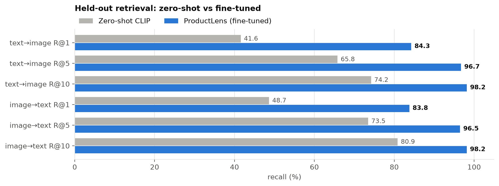
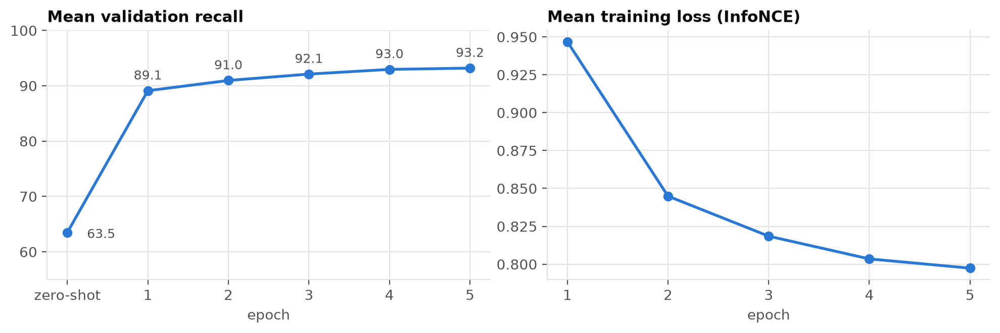
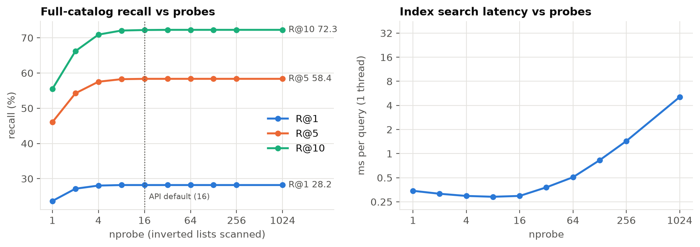
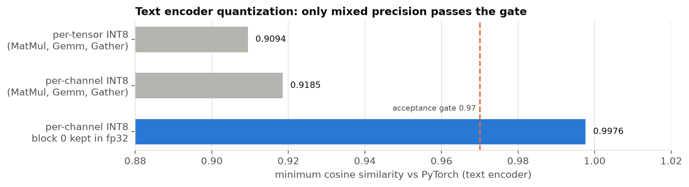
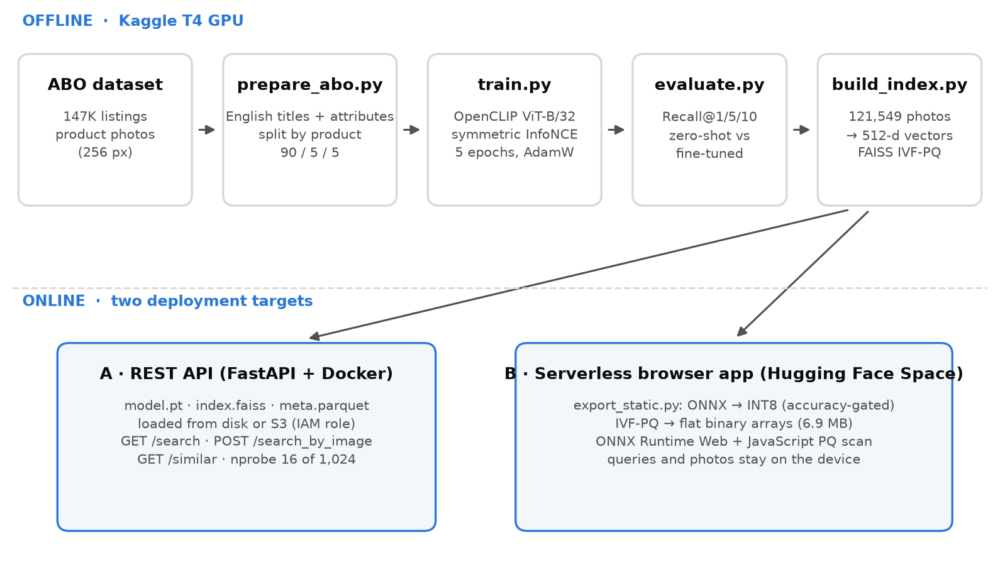

# ProductLens (OpenCLIP ViT-B/32 | Contrastive fine-tuning on ABO | FAISS IVF-PQ | ONNX INT8 | FastAPI + Browser)

ProductLens finds products in the Amazon Berkeley Objects (ABO) catalog from a text description
("stainless steel water bottle with bamboo lid") or from a photo. OpenCLIP ViT-B/32 is **contrastively fine-tuned on
the catalog's own image-title pairs**, which **doubles top-1 retrieval accuracy** over zero-shot CLIP
(41.6% → 84.3%). All 121,549 products are indexed with FAISS IVF-PQ (7.1 MB) and served two ways:
a FastAPI service in Docker, and a serverless web app where the INT8 encoder and the index run
entirely in the browser (ONNX Runtime Web), so queries and photos never leave the device.

> ProductLens is a retrieval system built on a public research dataset. It is not a store: no products are sold and no prices are shown.

## Demo

* **Live app:** [huggingface.co/spaces/ranjeet258/ProductLens](https://huggingface.co/spaces/ranjeet258/ProductLens)
* **ONNX models:** [huggingface.co/ranjeet258/ProductLens-onnx](https://huggingface.co/ranjeet258/ProductLens-onnx)
* **Dataset:** [Amazon Berkeley Objects](https://amazon-berkeley-objects.s3.amazonaws.com/index.html) (CC BY 4.0)

## Results (ABO held-out test split, Recall@K)

| Metric | Zero-shot CLIP | ProductLens |
|---|---:|---:|
| Text → image Recall@1 | 41.6% | **84.3%** |
| Text → image Recall@5 | 65.8% | **96.7%** |
| Text → image Recall@10 | 74.2% | **98.2%** |
| Image → text Recall@1 | 48.7% | **83.8%** |
| Image → text Recall@5 | 73.5% | **96.5%** |
| Image → text Recall@10 | 80.9% | **98.2%** |
| Mean recall | 64.1 | **92.9** |




**How the scores are measured.** The split is made **by product**, so no test product was seen in
training. Recall@K is the percentage of queries whose correct product appears in the top K results,
reported in both directions (text → image and image → text). Zero-shot and fine-tuned models are
scored on the same queries by `src/evaluate.py`. Every number in this README comes from the JSON
files in `results/`.

**Training progression (mean validation recall)**

| Zero-shot | Epoch 1 | Epoch 2 | Epoch 3 | Epoch 4 | Epoch 5 |
|---:|---:|---:|---:|---:|---:|
| 63.5 | 89.1 | 91.0 | 92.1 | 93.0 | 93.2 |

### Full-catalog retrieval

The same held-out queries, searched against all 121,549 products through the deployed IVF-PQ index:

| Text encoder | Size | Latency (1 CPU thread) | Recall@1 | Recall@10 |
|---|---:|---:|---:|---:|
| PyTorch fp32 | 242 MB | 126 ms | 28.2% | 72.3% |
| ONNX INT8 (browser) | 70 MB | 45 ms | 27.5% | 72.0% |




Exact-item recall drops on the full catalog because ABO lists many variants separately (for example,
one phone-case design for dozens of phone models, with identical photos). **74% of top-1 misses are
such near-duplicate variants**, and 61% of misses still have the exact item in the top 10. See the
[analysis notebook](notebooks/02_results_analysis.ipynb).

### System characteristics

| Property | Value |
|---|---|
| Catalog size | 121,549 products |
| Embedding dimension | 512 |
| FAISS IVF-PQ index | 7.1 MB (1,024 lists, 32 × 8-bit codes) |
| Catalog embedding throughput (T4) | 671 images/s |
| Index search, 16 of 1,024 lists | 0.30 ms per query (1 CPU thread) |
| Browser text encoder | 70 MB INT8, cosine 0.997 vs fp32 |
| Training time (T4) | about 39 minutes per epoch, 5 epochs |

## What fine-tuning changes (and why zero-shot CLIP falls short)

General-purpose CLIP handles everyday images and captions, but product listings are a different
domain: titles dense with brand names, model numbers and dimensions, and studio photos on plain
backgrounds.

| | Zero-shot CLIP | ProductLens | Keyword search |
|---|---|---|---|
| Search by photo | Yes | Yes | No |
| Understands product titles | Partially | Yes | Yes |
| Matches without shared words | Yes | Yes | No |
| Runs without a server | No | Yes | No |
| Text → image Recall@1 (this catalog) | 41.6% | **84.3%** | Not measured |

## Repository layout

```
src/                     core library
  train.py               contrastive fine-tuning (symmetric InfoNCE, learnable temperature)
  evaluate.py            Recall@1/5/10, zero-shot vs fine-tuned
  build_index.py         Flat or IVF-PQ FAISS index, optional S3 upload
  common.py              model loading, dataset, metrics
scripts/
  prepare_abo.py         ABO listings -> image-text pairs, split by product
  export_static.py       ONNX export, accuracy-gated INT8 quantization, browser index
  bench_latency.py       p50 / p95 / p99 latency against the running API
  make_synthetic.py      synthetic catalog for the smoke test
  publish_static.sh      one-command publish of the browser version
  kaggle/submit_pipeline.py   submit the full GPU pipeline to Kaggle
notebooks/
  01_training_pipeline_kaggle.ipynb   Kaggle T4: prepare -> fine-tune -> evaluate -> index
  02_results_analysis.ipynb           full-catalog eval, IVF probe sweep, INT8 vs fp32, storage
results/                 measured metrics (JSON) behind every number in this README
docs/                    technical report (PDF), build_report.py, figures
serve/                   FastAPI service and search page
static/                  browser application and Space configuration
tests/smoke_test.sh      end-to-end test on a synthetic catalog
Dockerfile               CPU serving image
```

Local-only folders (git-ignored): `artifacts/` (model, index, metadata), `static_site/` (built browser app), `data/`, `abo/`.

## Reproduce

Python 3.10 or later. A single NVIDIA T4 (16 GB) is enough for training; indexing, export and
serving run on CPU.

```bash
pip install -r requirements.txt
```

**1. Download and prepare the data (about 3.5 GB).**

```bash
mkdir abo && cd abo
wget https://amazon-berkeley-objects.s3.amazonaws.com/archives/abo-listings.tar
wget https://amazon-berkeley-objects.s3.amazonaws.com/archives/abo-images-small.tar
tar xf abo-listings.tar && tar xf abo-images-small.tar && cd ..
python scripts/prepare_abo.py --abo-root abo --out-dir data --use-other-images
```

**2. Fine-tune and evaluate.**

```bash
python src/train.py --train-csv data/train.csv --val-csv data/val.csv --image-root abo/images/small \
    --epochs 5 --batch-size 128 --lr 1e-5 --out runs/clip_abo
python src/evaluate.py --test-csv data/test.csv --image-root abo/images/small \
    --checkpoint runs/clip_abo/best.pt --out runs/clip_abo/test_metrics.json
```

If the GPU runs out of memory, reduce `--batch-size` or add `--unlocked-image-groups 4`.
No local GPU? Steps 1–3 run end to end on a free Kaggle T4:

```bash
pip install kaggle && kaggle auth login
python scripts/kaggle/submit_pipeline.py --user <kaggle-username>
```

**3. Build the index.**

```bash
python src/build_index.py --catalog-csv data/catalog.csv --image-root abo/images/small \
    --checkpoint runs/clip_abo/best.pt --index-type ivfpq --out artifacts
cp runs/clip_abo/best.pt artifacts/model.pt
```

**4a. Serve the API.**

```bash
docker build -t productlens .
docker run -p 8000:8000 -v $PWD/artifacts:/app/artifacts productlens
curl "localhost:8000/search?q=wooden%20coffee%20table&k=5"
curl -X POST -F "file=@some_product.jpg" "localhost:8000/search_by_image?k=5"
```

To load artifacts from S3, set `-e ARTIFACTS_S3_URI=s3://<bucket>/productlens/` and attach an
instance role with read access to that prefix.

**4b. Publish the browser version.**

```bash
export HF_TOKEN=hf_...   # Hugging Face token with write access
python scripts/export_static.py --artifacts artifacts --out static_site --push <hf-username>
```

This creates the model repo `<hf-username>/ProductLens-onnx` and a static Space `<hf-username>/ProductLens`.

**5. Tests.** Runs every stage on a synthetic catalog with a randomly initialized model; no GPU and no downloads.

```bash
bash tests/smoke_test.sh
```

## Architecture


* **Training:** ABO listings → English titles paired with product photos, split by product → OpenCLIP ViT-B/32 (LAION-2B) fine-tuned with symmetric InfoNCE + learnable temperature (AdamW lr 1e-5, weight decay 0.1, warmup + cosine, mixed precision, gradient clipping, in-batch negatives, 5 epochs).
* **Indexing:** every catalog photo → 512-d embedding → FAISS IVF-PQ (1,024 lists, 32 × 8-bit codes), about 35× smaller than raw float32 vectors.
* **API:** FastAPI in Docker loads `model.pt`, `index.faiss`, `meta.parquet` from disk or S3 (IAM role, no stored credentials) and probes 16 of 1,024 lists.
* **Browser:** encoders → ONNX → dynamic INT8, verified against PyTorch (cosine > 0.97); the index is flattened to binary arrays and searched in JavaScript with the same asymmetric distance computation FAISS uses, across all 1,024 lists.

**Implementation notes**

* **Similar-item search without an image model.** A product's vector is reconstructed from its PQ code and used directly as the query.
* **Lazy loading.** The image encoder is downloaded only when a user first searches by photo.
* **Native tokenizer.** OpenCLIP's byte-level BPE tokenizer is reimplemented in JavaScript and validated against token ids produced in Python during export.
* **Mixed-precision quantization.** After fine-tuning, the text encoder's first transformer block develops activation outliers that dynamic INT8 cannot represent well (cosine 0.91 vs PyTorch). Keeping that one block in fp32 restores cosine 0.998 at a cost of about 9 MB.

## API

| Method | Path | Purpose |
|---|---|---|
| GET | `/` | search interface |
| GET | `/health` | health check (used by the Docker `HEALTHCHECK`) |
| GET | `/search?q=<text>&k=10` | text query → top-k products |
| POST | `/search_by_image?k=10` | image upload → top-k products |
| GET | `/similar` | products similar to a given product |

## Documentation

* **[Technical report (PDF)](docs/ProductLens_Technical_Report.pdf):** problem, dataset, architecture, training, evaluation, quantization study, engineering challenges and comparison with alternatives.
* **[Training notebook](notebooks/01_training_pipeline_kaggle.ipynb):** the full GPU pipeline, step by step.
* **[Analysis notebook](notebooks/02_results_analysis.ipynb):** full-catalog evaluation, IVF probe sweep, INT8 vs fp32 encoder, storage footprint.

## Limitations

* The index is built from product photos, so attributes that are not visible (warranty, battery life, materials) are matched poorly.
* Only products in the ABO catalog can be retrieved.
* Near-duplicate variants (same photo, different model or size) limit exact-item recall on the full catalog to 28.2% at rank 1 and 72.3% at rank 10. A text re-ranking stage over the top results is the natural next step.
* The browser version downloads the text encoder on the first visit; it is cached afterwards.
* Product images load from the public ABO bucket. If it becomes unavailable, search still works without images.

## Acknowledgements

* Based on the original multimodal product search project by Mahendra Meena (MIT License).
* Amazon Berkeley Objects dataset, CC BY 4.0. Collins et al., "ABO: Dataset and Benchmarks for Real-World 3D Object Understanding", CVPR 2022.
* [OpenCLIP](https://github.com/mlfoundations/open_clip), [FAISS](https://github.com/facebookresearch/faiss) and [ONNX Runtime Web](https://onnxruntime.ai).

## License

Code: MIT, see [LICENSE](LICENSE). The ABO dataset is distributed under its own CC BY 4.0 license.

Maintained by [Ranjeet Gupta](https://github.com/ranjeet258).
